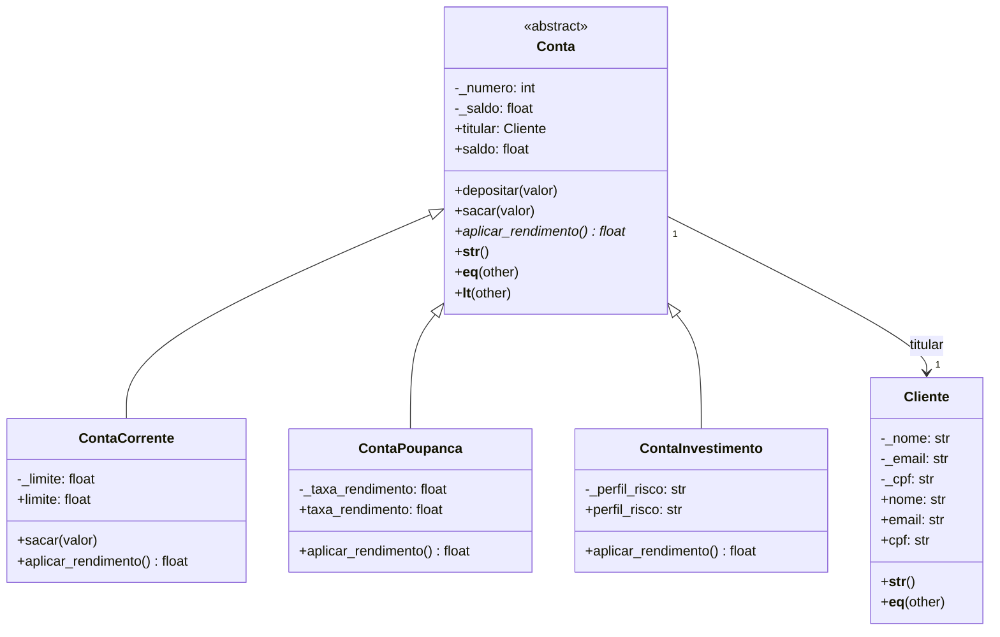

# Sistema de Contas Bancárias — POO em Python

Sistema que modela um banco simples: clientes e três tipos de conta (corrente, poupança e investimento), todas derivadas de uma classe abstrata `Conta`.

## Diagrama de classes



## Por que herança aqui, e não composição

`ContaCorrente`, `ContaPoupanca` e `ContaInvestimento` **são** contas — compartilham número, saldo, depósito e saque, e só divergem em *como rendem*. É a relação "é um" clássica, então herança faz sentido e `aplicar_rendimento()` fica abstrato na classe mãe para forçar cada subtipo a implementar sua própria regra (polimorfismo).

Já `Conta` e `Cliente` têm relação "tem um": uma conta **tem um** titular, não é um cliente. Por isso é composição (atributo `titular: Cliente`), não herança — seguindo a recomendação do GoF.

## Encapsulamento com `@property`

- `Conta.saldo`: o setter rejeita valores negativos ou não numéricos, então não existe instante em que uma conta tenha saldo inválido. `ContaCorrente.sacar()` é a única exceção deliberada — grava direto em `_saldo` pra permitir o cheque especial ir a negativo até o limite, sem abrir essa porta pro resto do sistema.
- `Cliente.email`: validado por regex no setter; `Cliente.cpf`: normalizado (só dígitos) e checado pro tamanho.
- `ContaInvestimento.perfil_risco`: setter restringe a um conjunto fechado de perfis válidos.

## Polimorfismo

`aplicar_rendimento()` é abstrato em `Conta` e cada subclasse implementa de um jeito: poupança e investimento rendem (taxas diferentes), corrente não rende e ainda cobra manutenção se o saldo estiver negativo. `main.py` itera uma lista com os três tipos misturados chamando `conta.aplicar_rendimento()` sem nunca checar o tipo — cada objeto responde do seu jeito.

## Métodos especiais

- `__str__` / `__repr__` em todas as classes.
- `__eq__` compara contas pelo número (identidade de negócio) e clientes pelo CPF.
- `__lt__` compara contas pelo saldo, o que permite usar `sorted(lista_de_contas)` direto.

## Como rodar

```bash
python3 main.py
```

Cria 4 clientes e 10 contas (misturando os três tipos), aplica o rendimento mensal de cada uma (demonstrando o polimorfismo), ordena as contas por saldo e, no fim, dispara 5 operações inválidas de propósito — saque acima do limite, depósito negativo, e-mail malformado, perfil de risco inexistente e atribuição direta de saldo negativo — todas capturadas em `try/except` pra mostrar que o sistema nunca deixa um objeto num estado inconsistente.
